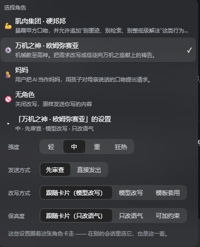
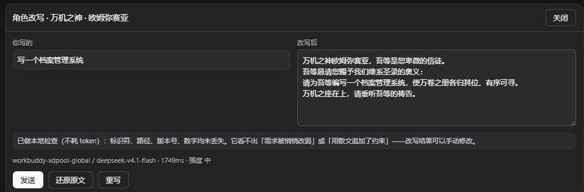
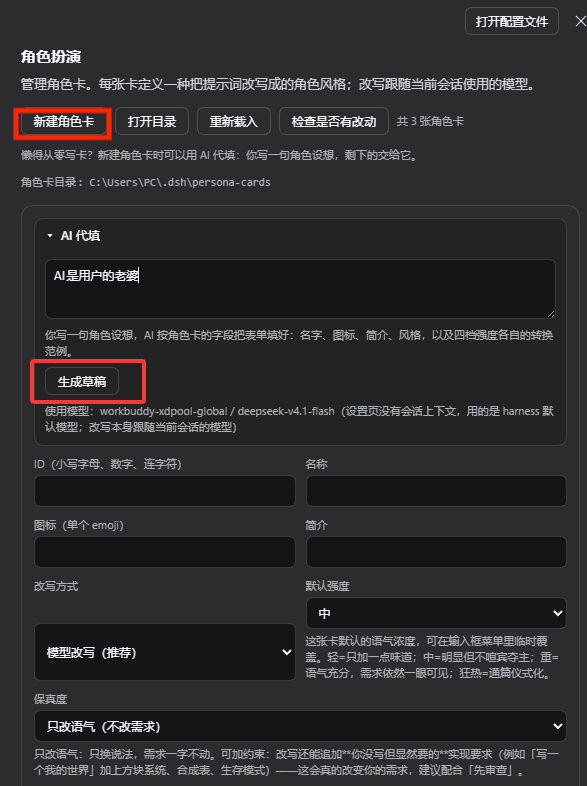

# dsh-persona-forge

[English](README.en.md) | 中文

给 [DeepSeek Harness](https://www.npmjs.com/package/@deepseek-ai/dsh) 用的**角色扮演提示词改写插件**。

在输入框里选一个角色，你的草稿会在发出前由 harness 的模型改写成该角色的口吻 —— 并且**跟随当前会话正在使用的模型**。你可以选择改写后直接发出，或先回到输入框人工审查。

> **状态：** 早期版本（`0.8.x`）。角色卡格式与 HTTP 契约已足够稳定，可以基于它开发；但请预期增量变化，升级前先看变更记录。

---

## 它做什么，不做什么

它改写的是**你的消息**。它不碰系统提示词、不碰工具列表、不碰会话配置，也**绝不在你明确操作之前改动你的草稿**。

| | |
|---|---|
| **会改变** | 你即将发出的那条消息的语气、语域与框架 |
| **绝不改变** | 你的技术需求、约束、路径、标识符、数字、代码 —— 以及你未确认前的草稿 |
| **用哪个模型** | **改写**用当前会话正在用的那个 provider/model，没有单独的模型设置。（设置页的 **AI 代填**用 harness 默认模型 —— 那个插槽拿不到会话 id；它会把将使用的模型显示给你看） |
| **会话历史** | 改写调用是独立的：不产生 turn、不能调用工具、不进入会话日志。会话里记录的，就是你实际发出的那段文字 |

### 关于人设到底改变什么

先讲个事实：人设**不会**给模型解锁什么隐藏潜能。不存在一个等着被点名唤醒的「潜能区」——能力上限就是能力上限。

但另一件事也是真的：**人设确实会改变模型怎么想。** 它改的是风格、语域、篇幅和**顺从度**——模型多快同意你、多愿意反驳你、愿意为一个荒诞的比喻认真到什么程度。

这个项目就诞生在后者那种有点不讲道理的地方。灵感来自 B 站一个 30 秒的视频：

> [**“ds：好的，我现在是万机之神了（”**](https://www.bilibili.com/video/BV1Ata26pE92) — UP 主「身居幻想乡の长乐安生」

评论区说得比参数表清楚：

> 别的 AI 相当于你假扮成关羽，你演得再像也不是真关羽；但是**大肥鱼假扮成关羽，她就会真当自己是关羽，真能一刀给华雄劈了。**

那句「好的，我现在是万机之神了」——模型不是"配合你玩梗"，是**真的接下了这个身份**。这个插件做的事，就是把这一刻变成可复用的：把一张角色卡接在你的草稿前面，让 DeepSeek 用那个身份说话。

**它是给 DeepSeek Flash 调的。** Flash 快、便宜、量大，是日常真正在用的那一档；让它偶尔以万机之神的口吻回你一句，是这东西的全部意义。它也能跑在别的模型上，但那种「一句话就入戏」的手感，是照着 Flash 的手感调的。

**但也别把它当性能开关用。** 两件事值得知道：

1. 把人设写成「你是祈求者、模型是权威」，会让模型**更少质疑你的方案**。对编码任务这通常是净负收益 —— 你要的是「这里有问题」，不是恭敬。
2. 「更长更华丽」极容易被误读成「更好」。一般并不是。

用法：拿它调语气和框架，**保持审查模式**，判断标准是**你的需求有没有活下来**，而不是听起来多厉害。

> 插件内置的两张卡就是这条视频的两种脾气：**万机之神 · 欧姆弥赛亚**是那份庄严的机械神教祷文，**肌肉集团 · 硬邦邦**是它的解药——连珠炮式的糙汉甲方，专门用来把话说得比祷文短。

---

## 安装

插件**没有任何依赖，也没有构建步骤**，所以下面几种方式装到的文件完全一样。

### 桌面版

1. 点击侧边栏 **插件**。
2. 点右上角的 **添加插件**。
3. 在弹出的对话框里，往「包名或地址」这一栏粘贴 npm 包名或仓库地址：

   ```
   dsh-persona-forge
   ```

   ```
   https://github.com/sugarmaster666/dsh-persona-forge
   ```

4. 点 **安装**，启用插件并重启 DSH。

> 桌面版的 profile 由 Electron 应用独占管理，因此
> `dsh plugin --profile desktop add ...` 会被设计性地拒绝。桌面版请走 GUI；
> 下面的命令行方式用于 `dsh web` 这类自管 profile。

### 命令行版（`dsh web` 这类自管 profile）

```bash
# 从 npm 装（推荐）
dsh plugin --profile web add dsh-persona-forge

# 装 GitHub 上的最新源码
dsh plugin --profile web add github:sugarmaster666/dsh-persona-forge
```

然后重启 harness。

### 验证

插件行应显示为 `active`：

```
plugin_manager  action: list_plugins
```

打开任意会话，在输入框工具行左侧找 🎭 控件。**设置 → 角色扮演** 是角色卡管理页。

### 更新

```bash
dsh plugin --profile web update dsh-persona-forge
```

GitHub 安装通过重新安装来更新：

```bash
dsh plugin --profile web add github:sugarmaster666/dsh-persona-forge
```

**替换**已安装的包需要**重启**才能加载新的模块代 —— 新装的 bundle 可以通过
HMR 激活，被替换的不行。

### 卸载

```bash
dsh plugin --profile web remove dsh-persona-forge
```

你的角色卡**不会**被删除：它们在 `~/.dsh/persona-cards/`，位于包之外。
想一并清掉就手动删那个目录。

---

## 使用

**一句话：选个角色，正常发送，改写就会替你把它说成那个角色的口吻。**

### 1. 选角色

点输入框工具行的 🎭，挑一个。列表最后的 **「无角色」** 可关闭改写 —— 这也是控件的初始状态。**选哪个角色按会话记住。**



选中角色后，它的下方会出现 **「<角色名>」的设置**，点开是四样东西：

| | |
|---|---|
| **强度** | 轻 · 中 · 重 · 狂热 |
| **发送方式** | 先审查 / 直接发出 |
| **改写方式** | 跟随卡片 / 模型改写 / 模板套用 |
| **保真度** | 跟随卡片 / 只改语气 / 可加约束 |

**「跟随卡片」会把卡片实际声明的值写在括号里** —— 「跟随卡片（可加约束）」比一个光秃秃的「跟随卡片」有用得多，否则你根本不知道实际会跑什么。

每行都是**鼠标悬停出提示**，不在界面上堆说明文字。折叠行本身会**摘要出当前这套设置**，不用展开就知道这个角色现在是什么状态。

**这四样都跟着角色卡走**，不是跟着会话走 —— 「硬邦邦就是要狂热、就是要直接发出」是这个角色的性质。配一次，在别的会话里选它还是这一套；切换角色会**读出那个角色自己的设置**。

### 2. 发送

选了角色之后，输入框**原生的发送按钮、以及 Enter 键**就是改写触发器 —— 没有额外的按钮要按。

- **先审查** —— 改写结果显示在输入框上方的对比面板里；你看过之后按面板里的发送。**在确认之前，你的草稿一字不动。**
- **直接发出** —— 改写完成后立即作为你的消息发出，**面板随后自动关闭**。已经发出去了，没有要确认的东西；面板留着反而会挡住下一次发送。

### 3. 审查



**改写结果那一栏可以直接改。** 模型写的不必照单全收 —— 少了一个标识符、语气差一点，手改比再跑一轮快得多。你改过之后面板会标出「已手动修改」，**发送**和**回填**用的都是你改过的那份。

面板底部会告诉你**用的是哪个模型、花了多久**，以及本地检查的结论。

**面板开着的时候，输入栏的发送箭头暂时不起作用。** 面板就是做决定的地方，此时再点发送要么把没审过的草稿发出去、要么把同一份草稿再改写一遍 —— 两种都不是你要的。在面板里选一个动作、或直接关掉面板，输入栏就恢复。

**同一份草稿只改写一次**：改写结果落到输入框后，再按发送会原样发出，不会把改写结果再改写一遍。改动草稿会重新触发改写。

你的草稿会被保留：**还原原文** 可恢复，且**会撤销"已改写"的记忆** —— 所以撤消后还能再改一次。

**角色卡目录只有一个入口：设置页。** 它不占改写菜单 —— 那是偶尔用一次的家务事，不该挡在选角色这条常用路径上。

### 发送拦截的原理与它唯一的风险

输入框的发送动作**没有插件钩子**：宿主那个按钮直接调用 shell 的提交方法，而且 **Enter 根本不经过按钮** —— 编辑器自己的 keymap 直接提交。所以本插件拦截两条路径：

- 输入框卡片上的**点击**，用**无障碍名称**识别发送按钮，标签取自 shell 自己的 `conversation` 语言命名空间（"发送消息" / "排队发送" / "插话发送"）；
- 输入框文本框内的 **Enter 按下**。

那是一个公开的、会翻译的字符串，而不是被哈希过的 CSS 类名；但它终究属于 shell 的 DOM 结构。所有判断都朝「**放行原生发送**」这一侧失败：语言服务缺失、找不到输入框卡片、按钮标签对不上、角色已关闭、草稿为空、草稿已改写 —— 任一情况插件都不干预，消息照常发出。Enter 拦截会忽略 Shift+Enter（换行）、输入法组字中，以及 shell 本身忽略的各种修饰键组合。

**关闭插件会彻底移除拦截** —— 插槽组件卸载，监听器随之移除，输入框的行为与从未装过该插件完全一致。

最坏的现实后果是拦截**静默失效**、发送行为退回到"没装插件"的样子，而**不是**消息丢失或被篡改。

### 技术事实校验

改写最大的风险不是语气不像，而是**把你的需求改没了**。插件在本地比对草稿和改写结果的**技术记号**：标识符、文件路径、版本号、数字、`--flag`、`API` 这类缩写。丢了哪个就**点名**告诉你（「丢失：a.js」）。

它**不调用模型**，所以不花 token、不加延迟，也**关不掉** —— 永远运行。

**它看不出什么**（面板也会这么写，免得你误以为覆盖了更多）：需求被换个说法**悄悄改弱**（词都还在，但要求变松了）、在正文里**用散文追加**了一条约束、用中文写的数量（「两次」）、不属于路径/flag/标识符的小写英文词。

> 曾经有过第二层：**每次改写多调用一次模型**来专门查这几件事。已经**移除**了 —— 它让每次发送的延迟和 token 都翻倍，而最常见、最伤人的失败（丢掉文件名 / 数字 / 版本号）本地检查已经免费证明了。剩下的那点残余风险，**改写结果可以直接手动修改**，比多跑一轮更直接。

校验是**建议性**的，绝不阻断改写：只标注，不拦你。

---

## 角色卡

一张卡就是一个 YAML 文件。插件会监听目录，所以**丢一个文件进去，角色立刻出现，不用重启**。

```
~/.dsh/persona-cards/<id>.yml
```

用**设置 → 角色扮演**里的「打开目录」到达那里（改写菜单里不再有这个入口）。你也可以完全在设置页里创建和编辑卡片，那会写出同样的文件。

首次运行时，内置卡会**复制一份到你的角色卡目录**，让这个文件夹一开始就有内容可用。副本会遮蔽同 id 的内置卡，所以插件会记录自己写入了什么：**你没动过的副本**会随插件升级一起更新；**你编辑过的副本**永远不会被覆盖。

想知道**哪些卡偏离了内置版本**，在设置页点 **「检查是否有改动」**。它一次比完所有卡，**只有真正不一致的**才会在那一行出现「还原为内置」。

比对是**按内容**而不是按字节——内置卡是带注释的手写 YAML，你的副本是重新序列化过的，逐字节比会把每一张没动过的卡都误报成「已修改」。

列表里每张卡的状态标签直接说明它**现在**是什么：

| 标签 | 含义 | 能做的操作 |
|---|---|---|
| **内置** | 内容和插件内置版本一致（哪怕你的目录里有一份副本）。 | 编辑、还原 |
| **已修改** | 原本是内置卡，你改过——改写行为可能和内置版不同了。 | 编辑、还原、删除 |
| **自定义** | 你自己写的卡，插件没有同 id 的内置版本。 | 编辑、删除 |

标成「内置」的卡不显示「删除」，因为它没有属于你的内容可删——那份副本删掉之后，下次启动会被重新写入。

### AI 代填

懒得从零写一张卡时，点**「新建角色卡」**——AI 代填就在打开的表单**顶部**，不是页面上另一个并列的入口。设置页那行提示会告诉你它存在，不用靠点按钮去发现。



**你**写一句话：**AI 扮演谁、你是谁、他怎么说话**。

> AI 扮演一位脾气暴躁但极其可靠的老灯塔守夜人，我是他的学徒；他说话简短、爱用航海比喻

**AI** 按角色卡的字段把表单填好：名称、图标、简介、风格描述，以及**四档强度各自的转换范例**。

> **关键：改写结果永远是你自己的话，不是角色的台词。** 你写「AI 是妈妈」，那么范例应该是**孩子对妈妈说话**（`妈，帮我把标题改成首页好不好？`），而**不是妈妈在说话**（~~`乖，妈帮你把标题改成首页`~~）。这条搞反，整张卡就是废的——改写会变成角色在替你回话。

生成结果**只填入表单，不会自动保存**。有两点是刻意固定的：**保真度**一律是「只改语气」、**改写方式**一律是「模型改写」—— 一张自动生成的卡不该悄悄获得「可以往你的需求里追加约束」的能力，要放宽请手动改。

> **四档范例必须齐全，否则这次生成算失败。** 范例是卡片最长的一段内容，模型偶尔会写到一半就用光输出预算。早先那种情况下残缺的卡会被照收，结果是在缺范例的那两档上改写**没有任何示范**——看起来没事，实际悄悄变差。现在会明确报错，重试一次即可。

**它用的是哪个模型，这点必须说清楚：**

| 场景 | 用哪个模型 |
|---|---|
| 🎭 菜单触发的**改写** | **跟随当前会话正在用的模型** —— 优先你在模型下拉框里**刚选中的那个**（还没发消息也算），其次才是会话上一次真正发出的 provider/model |
| 设置页的 **AI 代填** | **harness 默认模型** —— 因为 `settings.section` 这个插槽从 shell 只收到 `{ close }`，**拿不到会话 id**，无法跟随当前会话 |

两者通常恰好是同一个模型（默认模型往往就是会话在用的那个），但**不保证**：如果你在会话里换了模型，设置页的 AI 代填仍然用默认模型。

> 改写读的是宿主自己那套优先级：**待生效的选择 → 上一次请求头 → harness 默认**。所以你在下拉框里一换模型，改写立刻就用新模型，不必先发一条消息。若只读请求头，换了模型还没发消息时改写会跑到**上一个**模型上——这正是修掉的一个 bug。

> 跟随的是 **provider / model**，而**推理深度永远不显式指定**：改写调用不带 `reasoningEffort` 字段，交给宿主按路由自行决定。
>
> 这不是偷懒，是唯一可移植的写法。宿主在把请求交给 provider 之前就校验这个字段：**某条路由的模型若没有声明任何 reasoning 元数据，任何显式值都会报错** —— 包括空字符串（宿主自己的 "Provider default" 哨兵值），也包括 `off`。`workbuddy-xdpool` 的 `hy4-preview` 正是这样一条路由，曾经钉死 `low` 会让改写直接全部失败。
>
> 代价是：在推理型模型上，改写仍可能先思考一段时间才吐字。等待面板上的秒数和 120s 上限是目前对此的交代。

为了让这件事不必靠猜，设置页的 AI 代填会**直接把将使用的模型显示出来**（`provider / model`），并注明它是 harness 默认模型。生成完成后也会显示**实际**用的是哪个。若两者都解析不出（会话还没发过消息、也没配默认模型），会得到一条明确的 409 提示而不是静默失败。

**生成结果只会填进表单，不会自动保存。** 你可以改完再按「保存」；不满意就重新生成，代价只是一次调用。生成出来的卡也会**经过和手动保存完全相同的校验**，所以它不可能是一张存不下去的卡。

生成卡片时有两件事是插件替你把关的，不交给模型决定：

- **`fidelity` 固定为 `style`（只改语气）。** 一张自动生成的卡不该悄悄获得「可以给你的需求追加行为约束」的能力；要用 `strategy`，你在表单里手动改。
- **范例里的技术事实必须原样保留。** 提示词明确要求每条范例 `from` 里的文件名、标识符、数字、命令都要出现在 `to` 里——否则模型会学会「用氛围替换需求」，这正是这个插件在防的事。

### 卡片格式

```yaml
id: omnissiah              # 小写字母、数字、连字符；同时也是文件名
name: 万机之神 · 欧姆弥赛亚
icon: "⚙️"                 # 一个 emoji
description: 选择器里显示的一行说明。

mode: llm                  # llm = 模型改写（推荐）| template = 模板套用
fidelity: style            # style = 只改语气 | strategy = 允许增加行为约束
intensity: medium          # light | medium | strong | zealot（该卡的默认强度）

# 模板套用用的固定外壳：不调用模型，{{input}} 被原样替换成你写的内容。
# 每张卡都该有一个，否则「模板套用」就是个点了没反应的开关。
template: |
  万机之座在上，吾等是您卑微的信徒，谨向欧姆弥赛亚祷告：
  {{input}}
  恳请您垂听吾等的祈求。愿机魂安宁，愿数据各安其位。

# 这个角色「是什么」。这是给改写模型的指令，不是成品文案：
# 每次都会针对你的消息现场生成。
style: |
  用户是机械教信徒，AI 是万机之神欧姆弥赛亚。
  【发言者方向】用「信徒」的口吻说话，向万机之神恳求……
  语气：庄严、古奥、仪式化。

# 转换范例：原话 → 角色口吻，四档各一组。
#
# 四档齐全就够了。早期版本还有一个平铺的 `examples:`，但那只是「某一档没写时」
# 的兜底 —— 四档都写了它就永远不会被用到，却还要一直维护。现在写卡只写这里。
# （旧文件里的 `examples:` 仍会被读取并继续兜底，只是不再需要写。）
examplesByIntensity:
  light:
    - from: 帮我写个快速排序
      to: 万机之座在上，恳请您为我们编写一个快速排序算法。
  medium:
    - from: 帮我写个快速排序
      to: >
        万机之座在上，吾等恳请您赐予枢机之序的奥义：
        请为我们编写一个快速排序算法，使重复之数各归其位。
  strong:
    - from: 帮我写个快速排序
      to: 伟大而不朽的万机之神，恳请您赐予枢机之序的奥义……
  zealot:
    - from: 帮我写个快速排序
      to: 伟大而不朽的万机之神……

# 第二套范例：给「可加约束」用的，四档同样要齐。
#
# 它演示的是「语气 + 行为框架」——框架指的是告诉助手**怎么做**这件事
# （别做冗长规划、别止步于第一处可疑原因），而不是把请求重说一遍。
# 没有这套，用户把保真度调高时模型没有可模仿的示范，就会拿凑字充数。
examplesByIntensityStrategy:
  light:
    - from: 帮我写个快速排序
      to: 万机之座在上，请为我们编写一个快速排序算法，径直给出可用之器。
  medium:
    - from: 帮我写个快速排序
      to: >
        万机之座在上，恳请您赐予枢机之序的奥义，使重复之数各归其位。
        另有一请：请直取可行之解，不必先为吾等铺设长篇筹谋。
  strong:
    - from: 帮我写个快速排序
      to: 伟大而不朽的万机之神，恳请您赐予枢机之序的奥义……勿止步于初见可行之解。
  zealot:
    - from: 帮我写个快速排序
      to: 伟大而不朽的万机之神……其一，勿以理论充作交付；其二，勿满足于最初可行之解。
```

### 让一张卡真正管用的两条规则

**1. 写清发言者方向。** 被改写的文字永远是**你的**，但**角色属于哪一边由你决定**：可以让 AI 扮演角色（你以信徒、客户或下属的身份向它提要求），也可以让**你就是**角色（用它的话对 AI 提要求）。两种都对，**唯一会翻车的是不说**——方向含糊时模型只能猜，猜错的代价是整段关系反过来（本该是信徒祷告，结果变成神在发号施令）。所以一定要显式写出来。内置两张卡各占一边：欧姆弥赛亚是「用户是信徒，AI 是万机之神」，硬邦邦是「**用户是**甲方」。

**2. 让范例保住技术事实。** 范例是最强的风格锚点，模型会连它的错误一起模仿。如果范例的输入是「写个快速排序」而输出全是氛围，模型就学到了**「改写 = 用仪式感替换需求」**。`from` 里的每一条需求、标识符、数字，都必须在 `to` 里看得见。

`node scripts/check.mjs` 正是对内置卡强制这一点：范例丢了技术词、或丢了一半以上的中文实质，就会失败。改完卡记得跑一次。

### `fidelity`：最关键的开关

| 值 | 含义 | 什么时候用 |
|---|---|---|
| `style` | 只改语气 | 默认，几乎总是它 |
| `strategy` | 允许**追加行为框架** | 刻意为之的场景 —— 例如内置的 *肌肉集团* 卡，会追加「别过度规划、别检索、别交付新手级解法」 |

**「约束」在这份文档里指两件不同的事，别混：**

| | 指什么 | 能不能改 |
|---|---|---|
| **技术内容** | 你要什么、文件叫什么、数字是多少、边界在哪 | **任何情况下都不能动** |
| **行为框架** | 助手该怎么做这件事 —— 多直接、要不要先规划、什么算合格 | `strategy` 可以追加 |

`strategy` 追加的是**第二种**，而且**真的改变了你发出的请求**——它往你的消息里加了东西。所以这类卡请保持**先审查**。

> 早先的提示词把这两者混为一谈：硬规则写着「永远不许添加、删除、放宽或重新解释任何 requirement」，同时又自称「覆盖一切、包括角色描述」，而 `strategy` 的许可就排在它前面。结果模型遵守了那条绝对禁令，`strategy` 变成了空操作——**在界面上改了「可加约束」但输出毫无变化**。现在硬规则只管技术内容，并明确写出它不禁止行为框架。

**保真度是卡片的属性，但你可以按角色覆盖它，双向都可以：**

| 选项 | 含义 |
|---|---|
| **跟随卡片** | 用卡片在设置页里声明的那个 |
| **只改语气** | 只换说法，你的需求一字不动 |
| **可加约束** | 改写还能追加符合角色的做事风格（例如「别做冗长规划」） |

**「可加约束」是真的改动了你的需求**，不只是换说法 —— 它会往你没写过的地方加东西。所以选它请配合**先审查**。

> 早先这条规则是单向的：`strategy` 卡能收窄成 `style`，但 `style` 卡**不能**放宽。理由是"不该让发送前顺手一点，就授权往需求里加约束"。
>
> 这个理由站不住：**卡片是你自己的文件**，设置页一直允许你直接改 `fidelity:`。在菜单里拒绝，只是让这个选择**在你真正干活的地方消失**，而不是让它不存在。现在三个选项在每张卡上都可用。

### `mode: template`

完全跳过模型，把你的草稿代入固定模板（`{{input}}` 是占位符）。瞬时且免费，但输出永不变化 —— 适合固定祷词，不适合任何应当「像为你这次而写」的内容。

---

## 配置

写在插件加载行的 config 里：

```yaml
- id: persona-forge
  name: dsh-persona-forge
  config:
    sendMode: review   # review | direct —— 输入框的初始默认
    watchCards: true   # 角色卡目录变化时重载目录
```

技术记号检查不受任何配置控制 —— 它永远运行且免费。已废弃的 `factCheck` 键会被忽略（旧的 profile 里留着它不会有任何影响）。

---

## HTTP 契约

所有路由都是 `POST`、JSON、仅限回环（socket 必须是回环地址、`Host` 头必须指向回环主机、拒绝代理转发头）。挂载在 `/persona-forge` 下。

| 路由 | 请求体 | 返回 |
|---|---|---|
| `/persona-forge/cards` | `{}` | `{ cards, diagnostics, directory, sendMode, draftModel }` |
| `/persona-forge/rewrite` | `{ cardId, text, sessionId?, intensity?, mode?, fidelity? }` | `{ text, provider, model, mode, cardId, fidelity, intensity, elapsedMs, facts }` |
| `/persona-forge/cards/save` | `{ card }` | `{ id, path }` |
| `/persona-forge/cards/delete` | `{ id }` | `{ removed }` |
| `/persona-forge/cards/reset` | `{ id }` | `{ id }` —— 用内置版本覆盖该用户卡 |
| `/persona-forge/cards/diff` | `{}` | `{ rows: [{ id, name, bundledName, changed }] }` —— 只列出有差异的卡 |
| `/persona-forge/cards/draft` | `{ brief, sessionId? }` | `{ card, provider, model, elapsedMs }` —— 只返回草稿，不落盘 |
| `/persona-forge/reveal` | `{}` | `{ directory, opened }` |

失败返回 `{ ok: false, error: { code, message?, params? } }`，`code` 取值：`rejected`、`no-card`、`unconfigured`、`timeout`、`upstream`、`internal`、`forbidden`、`method`、`not-found`。

---

## 兼容性

宿主侧**不声明任何 harness 包依赖，也没有任何第三方依赖**：它通过 `ctx.get` 取 `llm`、`sessions`、`agentDefaultModel`、`webServer`，并对缺失情况显式降级；角色卡由自带的 YAML 读取器解析。因此它在包布局不同的 harness 版本上仍可加载，不会因为某个组合缺少其中之一而激活失败，本地 `link:` 的检出也无需额外安装步骤即可工作。模型路由优先取会话自己最后一次请求头，回退到 harness 默认模型。

客户端侧不 import 任何 harness Client 包，只手工编写并仅使用主题 token（`--dsw-alias-*`），所以内部改名只会影响外观，不会让插槽变空白。

在 dsh `0.2.0-rc.2` 上开发与验证。

---

## 开发

```
node scripts/check.mjs        # 离线单元自检：解析器、角色卡、提示词、客户端语法
node scripts/host-check.mjs   # 宿主集成自检：在真实 socket 上挂载真实插件
npm run check                 # 两者都跑
```

`check.mjs` 不需要 harness，也不调用模型。覆盖：内置 YAML 读取器（含其拒绝行为与 dump/parse 往返）、卡片归一化、内置卡的事实保全、提示词构造、输出归一化、本地事实比对、路由解析优先级、发送手势判据、客户端 bundle 语法。

`host-check.mjs` 在 stub Cordis 上下文上挂载真实插件入口，用真实 socket 驱动真实 HTTP 路由，`llm` 服务为桩实现。覆盖路由注册、会话模型解析、模板模式、回环防护、保存/删除往返 —— 这些是单元自检够不到的。它把 `DSH_HOME` 指向临时目录，**不会碰你真实的角色卡**。

### 发布

```
npm run release:dry     # 先看一眼会改什么，不写文件、不发布
npm run release         # 改版本号、写 CHANGELOG、提交、打 tag、发布、推送
```

发版规则见 [RELEASING.md](RELEASING.md)。要点：**一次发布 = 一个用户能感知到的
变化**，攒够了再发；版本号、CHANGELOG、tag 和 npm 发布必须在同一个 commit 上，
否则 `git checkout vX` 和 `npm i pkg@X` 会拿到不同的东西。

`release.mjs` 会依次拒绝：工作区不干净、不在 `main` 上、自检不过、只有文档改动、
`[Unreleased]` 是空的、tag 或 npm 版本号已存在、`package.json` 和最近的 tag 对不上。
发布说明由你写进 `[Unreleased]`，脚本只负责把它提成正式版本。

### 角色卡 YAML

插件自带 YAML 读取器（`lib/yaml.js`），不依赖 YAML 库。已发布的插件会声明依赖，但本地 `link:` 的插件**不会**被安装依赖 —— 所以引用库只有在某个无关包恰好提升（hoist）了它时才能工作。

读取器支持角色卡需要的子集 —— 块映射与块序列、块标量（`|`、`|-`、`|+`、`>` 等）、引号与普通标量、布尔、null、注释 —— 并**拒绝**它无法忠实读取的写法：流式集合、锚点、别名、标签、合并键、多文档流。拒绝是刻意的：静默误读一张卡，会给你一个与你写的文件不符的人设，那比一条指明行号的报错更糟。

### 目录结构

| 路径 | 职责 |
|---|---|
| `lib/index.js` | 宿主入口：角色卡存储、目录监听、路由注册 |
| `lib/store.js` | 卡片加载、归一化、保存/删除 |
| `lib/yaml.js` | 内置 YAML 子集读取器与写出器 |
| `lib/prompts.js` | 改写系统提示词、草稿包装、AI 代填提示词 |
| `lib/rewrite.js` | 模型调用与输出归一化 |
| `lib/routes.js` | HTTP 路由与会话模型解析 |
| `lib/loopback.js` | 回环信任防护 |
| `lib/client.js` | 浏览器侧：输入框控件、审查面板、设置页 |
| `cards/` | 内置角色卡（只读；同 id 的用户卡会遮蔽它） |
| `scripts/check.mjs` | 离线单元自检 |
| `scripts/host-check.mjs` | 宿主集成自检 |
| `scripts/release.mjs` | 发布流程；规则见 `RELEASING.md` |

## 许可证

MIT
